  

  

<h2>👨‍💻 About Me</h2>

<h2>🛠️ Tech Stack</h2>

<h2>📊 GitHub Stats</h2>

 

<h2>🚀 Featured Projects</h2>

<!-- Replace REPO-1 and REPO-2 with your real repository names -->

<h2>🐍 Contribution Snake</h2>

 

