  

  <strong>Software Engineer</strong> · BS Software Engineering · Islamabad, Pakistan

  <a href="https://www.linkedin.com/in/kashif-hussain-8b131a299/">LinkedIn</a>
  &nbsp;·&nbsp;
  <a href="https://github.com/Kashifhussain241">GitHub</a>
  &nbsp;·&nbsp;
  <a href="#connect">Connect</a>

---

## About

I'm a software engineer focused on building practical, maintainable applications across the full stack. My experience includes modern web interfaces, ASP.NET Core APIs, database-driven systems, and responsive user experiences.

- Building with **React, JavaScript, C#, and ASP.NET Core**
- Exploring **authentication, authorization, and clean backend architecture**
- Interested in **full-stack, backend, and junior software engineering opportunities**

---

## Featured Projects

<table>
  <tr>
    <td width="50%" valign="top">
      
      <h3>Personal Developer Portfolio</h3>
      
Responsive portfolio website showcasing projects, skills, and contact information.

      

        &nbsp;
        &nbsp;
        
      

      
<a href="https://github.com/Kashifhussain241/My-Portfolio-website"><b>View Repository</b></a>

    </td>
    <td width="50%" valign="top">
      
      <h3>E-Commerce Website</h3>
      
A web commerce project demonstrating product browsing and storefront fundamentals.

      

        &nbsp;
        &nbsp;
        
      

      
<a href="https://github.com/Kashifhussain241/-E-Commerce-Website"><b>View Repository</b></a>

    </td>
  </tr>
  <tr>
    <td width="50%" valign="top">
      
      <h3>React Practice</h3>
      
A collection of React exercises and components for hands-on frontend practice.

      

        &nbsp;
        &nbsp;
        
      

      
<a href="https://github.com/Kashifhussain241/react-practice"><b>View Repository</b></a>

    </td>
    <td width="50%" valign="top">
      <h3>Projects in Development</h3>
      
<b>TJ Sports Complex</b> — sports facility, tournament, and membership management.

      
<b>DriverDoc</b> — REST API and React application for vehicle maintenance management.

    </td>
  </tr>
</table>

---

## Technology Stack

| Area | Technologies |
|---|---|
| Frontend |      |
| Backend |     |
| Databases |   |
| Tools |     |

---

## GitHub Activity

  
  

  

---

## Currently Learning

`Advanced React` · `ASP.NET Core Web API` · `Authentication & Authorization` · `Entity Framework Core` · `SQL Server` · `Backend Architecture`

---

<h2 id="connect">Connect With Me</h2>

| | |
|---|---|
| **GitHub** | [github.com/Kashifhussain241](https://github.com/Kashifhussain241) |
| **LinkedIn** | [Kashif Hussain](https://www.linkedin.com/in/kashif-hussain-8b131a299/) |
| **Interests** | Full-stack development, REST APIs, backend systems, database design |

  Open to junior and entry-level software engineering roles, including remote opportunities. 
  Let's build reliable, maintainable, and thoughtful software.

