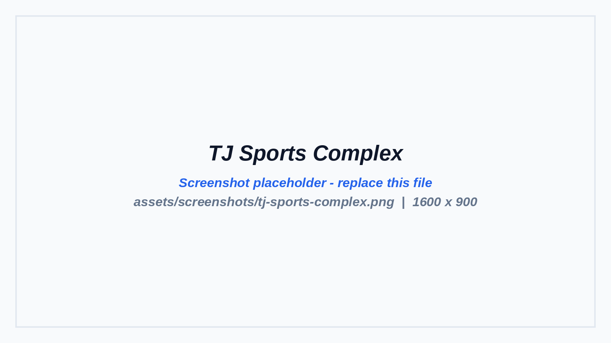
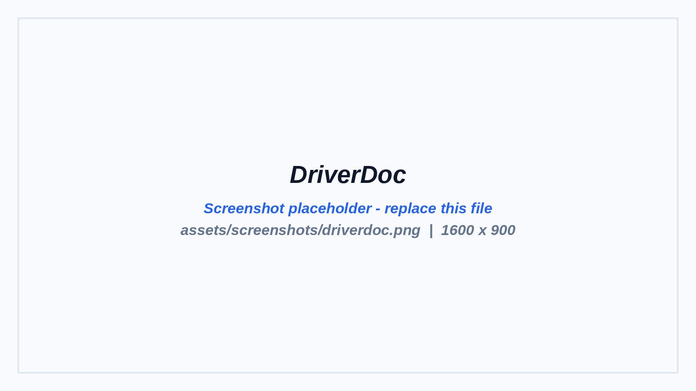
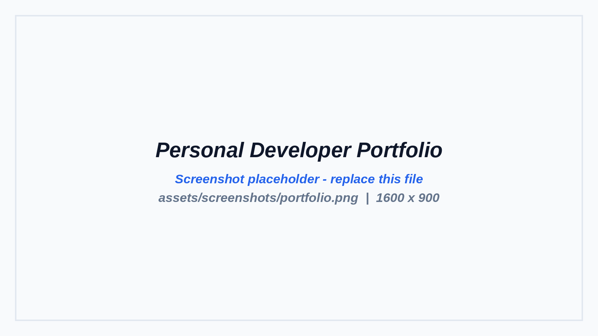

  

  BS Software Engineering, Iqra University, Islamabad, Pakistan

  <a href="https://www.linkedin.com/in/kashif-hussain-8b131a299/">LinkedIn</a> &nbsp;·&nbsp;
  <a href="https://github.com/Kashifhussain241">GitHub</a> &nbsp;·&nbsp;
  <a href="#connect">Contact</a>

---

## About

I'm a Software Engineering graduate who builds modern web applications, backend systems, REST APIs, and database-driven software. I enjoy turning real requirements into clean, maintainable, practical solutions, from the React interface to the ASP.NET Core API and the SQL Server database behind it.

---

## Featured Projects

<table>
  <tr>
    <td width="50%" valign="top">
      
      <h3>TJ Sports Complex</h3>
      
Sports facility management with tournament and membership features.

      

        &nbsp;
        &nbsp;
        &nbsp;
        
      

      
<a href="https://github.com/Kashifhussain241/YOUR-TJ-SPORTS-REPO"><b>Repository</b></a>

      <!-- Add a live demo link here only if one exists: &nbsp;·&nbsp; <a href="URL"><b>Live Demo</b></a> -->
    </td>
    <td width="50%" valign="top">
      
      <h3>DriverDoc</h3>
      
Vehicle maintenance management built on a REST API.

      

        &nbsp;
        &nbsp;
        
      

      
<a href="https://github.com/Kashifhussain241/YOUR-DRIVERDOC-REPO"><b>Repository</b></a>

    </td>
  </tr>
  <tr>
    <td width="50%" valign="top">
      
      <h3>Personal Developer Portfolio</h3>
      
Responsive portfolio showcasing my projects and contact details.

      

        &nbsp;
        &nbsp;
        &nbsp;
        
      

      
<a href="https://github.com/Kashifhussain241/YOUR-PORTFOLIO-REPO"><b>Repository</b></a>

    </td>
    <td width="50%"></td>
  </tr>
</table>

---

## Technology Stack

<table>
  <tr>
    <td width="110"><b>Frontend</b></td>
    <td>
      &nbsp;&nbsp;
      &nbsp;&nbsp;
      &nbsp;&nbsp;
      &nbsp;&nbsp;
      
    </td>
  </tr>
  <tr>
    <td><b>Backend</b></td>
    <td>
      &nbsp;&nbsp;
      &nbsp;&nbsp;
      &nbsp;&nbsp;
      
    </td>
  </tr>
  <tr>
    <td><b>Database</b></td>
    <td>
      &nbsp;&nbsp;
      
    </td>
  </tr>
  <tr>
    <td><b>Tools</b></td>
    <td>
      &nbsp;&nbsp;
      &nbsp;&nbsp;
      &nbsp;&nbsp;
      &nbsp;&nbsp;
      
    </td>
  </tr>
</table>

---

## GitHub Activity

  
  &nbsp;
  

  

---

## Currently Learning

Advanced React.js &nbsp;·&nbsp; ASP.NET Core Web API &nbsp;·&nbsp; Authentication and Authorization &nbsp;·&nbsp; Entity Framework Core &nbsp;·&nbsp; SQL Server &nbsp;·&nbsp; Backend Architecture &nbsp;·&nbsp; Clean Code and Software Design

---

<h2 id="connect">Connect With Me</h2>

| | |
|---|---|
| **GitHub** | [github.com/Kashifhussain241](https://github.com/Kashifhussain241) |
| **LinkedIn** | [linkedin.com/in/kashif-hussain-8b131a299](https://www.linkedin.com/in/kashif-hussain-8b131a299/) |
| **Email** | `your-professional-email@example.com` (placeholder) |
| **Portfolio** | `https://your-portfolio-url.com` (placeholder) |

---

  Open to junior and entry-level full-stack roles, including remote opportunities. 
  I'm always glad to talk about building reliable, well-designed software.

